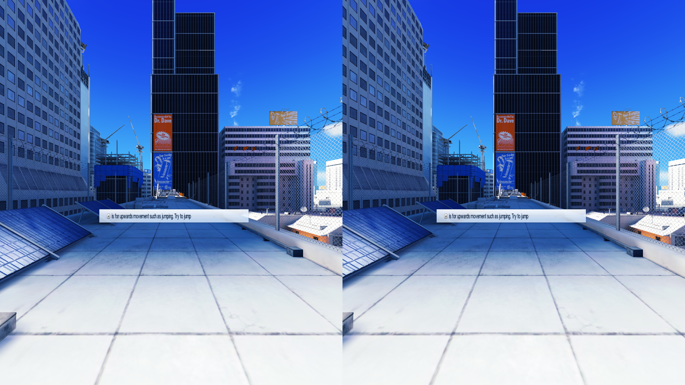

# Mirror's Edge VR on macOS → Meta Quest

An experiment: can a **static recompilation** of *Mirror's Edge* (2008) running natively on Apple Silicon be combined
with an existing **Windows VR mod** and streamed to a **Meta Quest 3**, with no Windows, Wine or Rosetta anywhere in
the chain?

It works. The game runs as native arm64 code on the Mac, renders per-eye stereo with 6-DoF head tracking, takes Touch
controller input, and streams to the Quest over USB as hardware H.265.

> **No game files are included or linked.** You need your own GOG copy of *Mirror's Edge* 1.01. This repository holds
> only original glue code, a Win32 compatibility layer, and patches against the open-source projects listed below.

## Why this was attempted

I have a **MacBook Pro with an M4 Pro** and wanted to find out whether a recompiled PC game plus a VR mod written for
Windows could run on it at all, and how close it could get to a Windows PC VR setup. Apple Silicon has no PC VR
path: no SteamVR, no Quest Link, and no D3D9. The open question was whether a recomp could stand in for Windows and a
streaming runtime could stand in for the Quest PC tools.

## Why Mirror's Edge suits VR

Mirror's Edge is played entirely from Faith's point of view. The camera is her head, not a camera floating behind or
above a character, and the game is built around that first-person body: you see your arms and legs as you run, vault
and climb, and the whole movement design depends on reading the world from eye height. In the engine, the
first-person camera is built in the player pawn itself, so a VR mod can hand that view to the headset and let your
real head move it. Few games of its era are designed this naturally for being *inside* the character, which is why
the original VR mod chose it.

## How it fits together

```
GOG MirrorsEdge.exe (x86)
  └─ RunnerRecompiled (lifted to C, compiled for arm64)        ← patched: VR module hooks
       ├─ Direct3D 9 calls → slot table → VR mod hooks → DXVK (D3D9 → Vulkan) → MoltenVK (Metal)
       ├─ guest memory (the game's own 32-bit addresses)        → read/written by the mod's Unreal object code
       ├─ entry hooks in the recompiler for 3 game functions   → the mod's arm / skeleton / script detours
       └─ audio mix                                            → streamed to the headset
  └─ libmevr.dylib = the VR mod's own source, compiled for arm64 (this repo)
       └─ OpenXR (XR_KHR_vulkan_enable2) on DXVK's Vulkan device
            └─ OXRSys (macOS OpenXR runtime) → VideoToolbox H.265 → USB (adb) → OXRSys Quest app
```

What this repository adds:

- **`mevr-mac/`**: everything that lets the Windows mod compile and run on macOS.
  - `port_patch.py` applies small, `MEVR_MAC`-guarded edits to the mod's source; the Windows build is unchanged.
  - `compat/mevr_win32.h` is a Win32 shim. The mod reaches game memory only through
    `ReadProcessMemory`/`WriteProcessMemory`, and the recompiled game keeps every original address, so the shim
    simply maps those calls onto the recomp's guest memory.
  - `src/mevr_mac.cpp` is the glue: OpenXR on DXVK's Vulkan device (instead of the mod's D3D11 path), GPU copies
    through DXVK's interop interface, D3D9 hooks through the runtime's slot table, game-function hooks and calls into
    game code, XInput, and audio.
- **`patches/RunnerRecompiled-mevr.patch`**: a small VR module ABI for the recompiled runtime (`rt_vr.h`):
  - D3D9 method overrides
  - guest memory access
  - a gamepad hook
  - recompiler entry hooks for three game functions
  - calls from host into game code
  - the audio tap
- **`mevr-mac/dxvk_patch.py`**: lets the VR module create DXVK's Vulkan instance and device through OpenXR.
- **`patches/OXRSys-mevr.patch`**: runtime and Quest-client fixes found along the way:
  - swapchains a Vulkan app can copy into
  - thumbstick clicks
  - holding the last frame through long game pauses
  - refresh-rate negotiation
  - a game-audio player in the Quest app
- **`setup.sh`** and **`run-vr.sh`**: one-command setup from your game installer, and one launcher, with a quick start
  straight into any of the game's checkpoints.

Workarounds handled in the glue (OXRSys specifics):

- OXRSys streams only frames that have a projection layer, so menu-only frames get a black projection layer.
- OXRSys ignores the FOV an app submits, so each eye's image is cropped to the headset's own FOV.

## Status

Working on an M4 Pro MacBook Pro with a Quest 3 over USB 3:

- stereo at 72 Hz, a steady 72 fps on the Mac
- head tracking, Touch controllers and the mod's in-headset VR menu
- quick start into checkpoints
- streaming as H.265 at 4128x2208

Known issues and limits:

- **Sky culling FOV is capped.** Mirror's Edge's sky breaks when the engine FOV goes above about 140°, so the VR
  culling FOV is capped at 135°. Objects at the very edge of each eye may pop in slightly late.
- **First visit to a level stalls.** The first visit compiles shaders (DXVK on MoltenVK), so loads can stall; later
  visits are faster.
- **Intermittent lost GPU device.** An intermittent `VK_ERROR_DEVICE_LOST` is a known RunnerRecompiled issue on
  macOS; restarting fixes it.
- **Motion features are untested.** Motion hands, pistols and parkour are hooked but mostly untested in the headset.
- **Headset audio is new.** Audio to the headset is new and lightly tested.
- **USB 2.0 cables stutter.** Use a USB 3 cable; at 480 Mbit/s the stream stutters above about 80 Mbit/s.

## Setup

You need an Apple Silicon Mac (macOS 14 or later), the Xcode Command Line Tools, [Homebrew](https://brew.sh), about
20 GB free, a Quest 3 with developer mode, a **USB 3** USB-C cable, and the GOG offline installer of *Mirror's Edge*
1.01 (`setup_mirrors_edge_1.01_jpfix_(41238).exe` plus its `-1.bin`, `-2.bin`, `-3.bin` parts).

```bash
git clone https://github.com/mrchrisster/mirrors-edge-vr-mac
cd mirrors-edge-vr-mac
./setup.sh ~/Downloads/'setup_mirrors_edge_1.01_jpfix_(41238).exe'
```

`setup.sh` does everything, inside this folder:
- installs the Homebrew packages it needs
- downloads the pinned upstream projects and applies the patches
- extracts and recompiles your copy of the game (10 to 20 minutes the first time)
- builds DXVK, the OpenXR loader, the OXRSys runtime and the VR module
- writes OXRSys settings that work well over USB
- installs the OXRSys Quest app if the headset is connected

The Quest app comes prebuilt from this repo's Releases page, or is built locally if you have the Android SDK. The
script is safe to re-run.

Then connect the Quest by USB, put it on, and run:

```bash
./run-vr.sh                                   # start the game in VR
MEVR_START=Before_Balance_Walk ./run-vr.sh    # or jump straight into a checkpoint
MEVR_START=--list ./run-vr.sh                 # list the checkpoints
```

**On a USB 2 link:** the stream stutters at 480 Mbit/s. Check the link with
`system_profiler SPUSBHostDataType | grep -A12 Quest`. If it shows 480 Mbit/s, lower `bitrate_mbps` to 80 in
`~/Library/Application Support/OXRSys/oxrsys-runtime.toml`.

## Credits

This builds directly on other people's work:

- **[RunnerRecompiled](https://github.com/prasys/RunnerRecompiled)** (MIT): the static recompilation of
  *Mirror's Edge* for macOS (prasys, after singlemate's original project). Everything here runs inside it.
- **[mirrors-edge-vr-mod](https://github.com/letsgosportsteam/mirrors-edge-vr-mod)** (MIT, letsgosportsteam): the
  VR mod itself: stereo rendering, head tracking, controls, hands, parkour, the VR menu. This port compiles its
  source largely unchanged.
- **[OXRSys](https://github.com/demonixis/OXRSys)** (MPL-2.0, demonixis): the macOS OpenXR runtime and Quest client.
- **[DXVK](https://github.com/doitsujin/dxvk)**, **MoltenVK**, **SDL3**, the **Khronos OpenXR loader**, and
  **[WiVRn](https://github.com/WiVRn/WiVRn)** (used for the first headset tests).
- *Mirror's Edge* © Electronic Arts / DICE. This is an unofficial fan project, not affiliated with or endorsed by
  them.

## Acknowledgements: AI use

This port was built in one long working session with an AI coding assistant, **Claude by Anthropic**, running in
Claude Code on the Mac. The assistant did most of the work:

- read the mod's source
- wrote the Win32 shim, the glue and the patches
- built the projects
- ran unattended test runs
- diagnosed problems from logs and captured frames

I directed the work, tested in the headset and made the calls. Treat the code accordingly: it works on the setup
above, but it has not had a human review line by line.

## License

The original code in this repository (`mevr-mac/`, `run-vr.sh`) is released under the MIT License (see `LICENSE`).
The patches modify third-party projects and are offered under those projects' licenses (MIT for RunnerRecompiled
and the VR mod, zlib/libpng for DXVK, MPL-2.0 for OXRSys).
